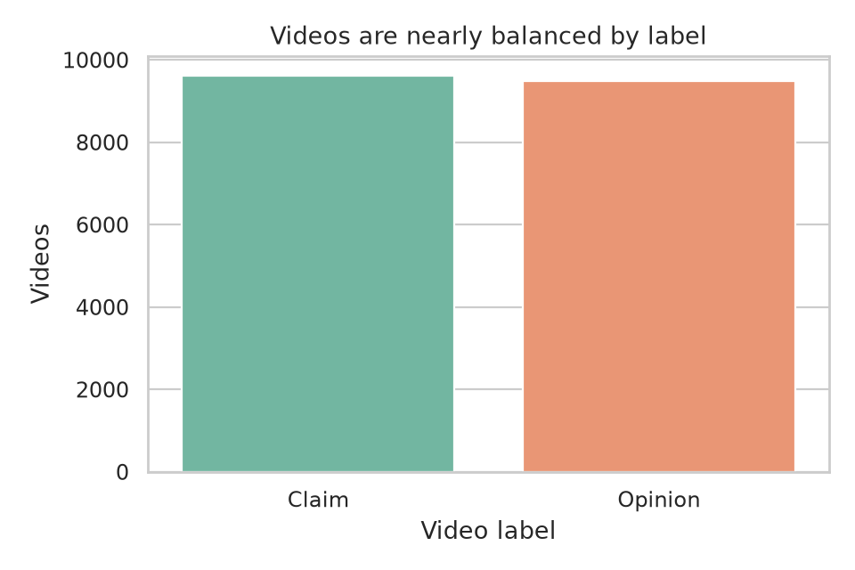
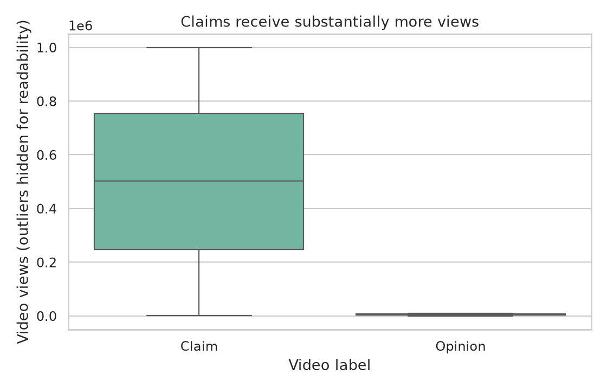
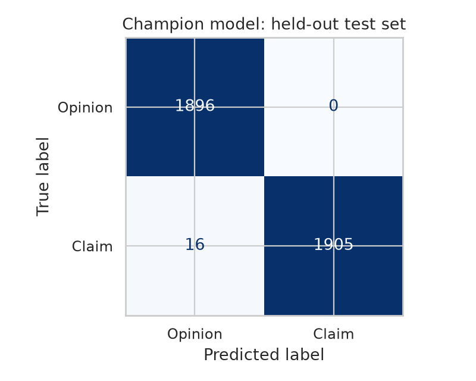
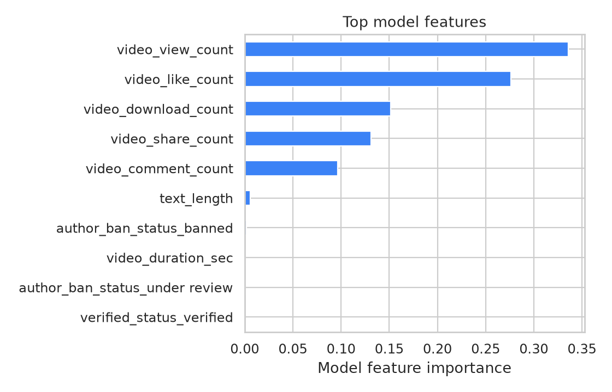

# TikTok Claim Classification

An end-to-end data analytics and machine learning project developed during the
Google Advanced Data Analytics Professional Certificate. The project explores
how TikTok video metadata and engagement patterns can help a moderation team
prioritize videos that contain **claims** rather than **opinions**.

> A claim prediction does not mean that a video contains misinformation. It
> identifies content that may warrant fact-checking or human review.

## Project outcome

The tuned random forest was selected on validation F1 and evaluated once on a
held-out test set of 3,817 videos.

| Metric | Test result |
|---|---:|
| Accuracy | 99.58% |
| Precision (claim) | 100.00% |
| Recall (claim) | 99.17% |
| F1 (claim) | 99.58% |

It correctly classified 3,801 of 3,817 test videos. All 1,896 opinion videos
were classified correctly, while 16 of 1,921 claim videos were missed.

These results are unusually strong because engagement signals sharply separate
the two classes in this educational dataset. They should be treated as evidence
that the workflow works on this dataset, not as an estimate of real-world TikTok
performance.

## Key findings

- The cleaned modeling sample contains 19,084 videos and is nearly balanced:
  50.35% claims and 49.65% opinions.
- Claim videos have a median of 501,555 views, compared with 4,953 for opinion
  videos.
- Videos from unverified authors average 265,664 views, compared with 91,439
  for verified authors. A Welch t-test finds a statistically significant
  difference (`p < 0.001`), though this does not establish causality.
- View count and like count are the random forest's strongest features, followed
  by downloads, shares, and comments.

## Project screenshots

| Dataset overview | Engagement analysis |
|---|---|
|  |  |

| Held-out evaluation | Model interpretation |
|---|---|
|  |  |

## Project highlight cards

Full-resolution summary graphics are available for presentations and portfolio
posts:

1. [Project overview](assets/project-highlights/01_project_overview.png)
2. [Key findings](assets/project-highlights/02_key_findings.png)
3. [Model results](assets/project-highlights/03_model_results.png)

## Analytical approach

The work follows the PACE framework used in the certificate:

1. **Plan** — define claim classification as a moderation-triage problem.
2. **Analyze** — inspect data quality, distributions, engagement, and group
   differences.
3. **Construct** — compare a majority baseline, logistic regression, random
   forest, and XGBoost using a stratified 60/20/20 split.
4. **Execute** — select the model on validation F1, evaluate it once on the test
   set, and translate the result into a cautious product recommendation.

All transformations are fit only on training data. Random forest and XGBoost
hyperparameters are tuned with five-fold cross-validation inside the training
split, which keeps validation and test results independent of model fitting.

## Repository structure

```text
.
├── assets/
│   └── project-highlights/              # shareable project summary cards
├── data/
│   └── tiktok_dataset.csv
├── notebooks/
│   ├── tiktok_claims_portfolio.ipynb    # polished end-to-end narrative
│   └── coursework/                      # original five-stage learning path
├── reports/
│   ├── figures/                         # generated portfolio visuals
│   └── metrics.json                     # machine-readable results
├── src/
│   └── analysis.py                      # reproducible training pipeline
└── requirements.txt
```

## Run locally

Python 3.12 is recommended.

```bash
python -m venv .venv
source .venv/bin/activate
python -m pip install -r requirements.txt
python src/analysis.py
```

Open [`notebooks/tiktok_claims_portfolio.ipynb`](notebooks/tiktok_claims_portfolio.ipynb)
for the complete presentation. Running the source script regenerates
`reports/metrics.json` and every image under `reports/figures/`.

## Tools

Python, pandas, NumPy, SciPy, Matplotlib, seaborn, scikit-learn, XGBoost, and
Jupyter.

## Limitations and next steps

- The dataset was supplied for the Google certificate capstone and may be
  synthetic or curated for instruction. Its results should not be generalized
  without validation on current, independently sampled platform data.
- Engagement counts accumulate after publication, so this model cannot classify
  a video at upload time. An early-warning model would need content, creator,
  and short-window behavioral features available at prediction time.
- A production review should add probability calibration, subgroup fairness
  tests, drift monitoring, cost-sensitive threshold selection, and human
  oversight.
- Feature importance describes how the model splits this dataset; it does not
  imply that engagement causes a video to contain a claim.

## Data attribution

The dataset and original project scenario were provided as part of the Google
Advanced Data Analytics Professional Certificate TikTok capstone. This
repository is an independent educational portfolio project and is not affiliated
with or endorsed by TikTok or Google.
